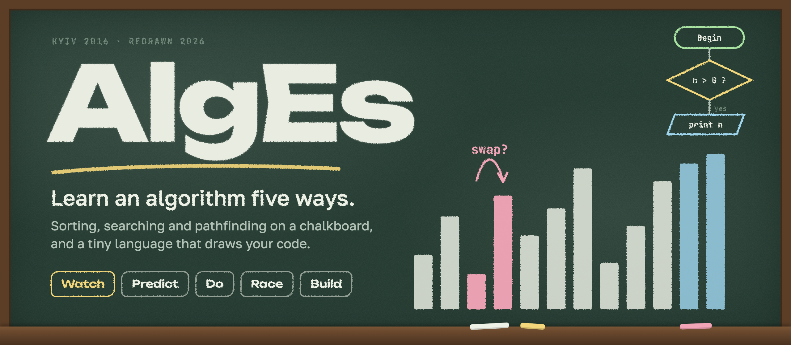
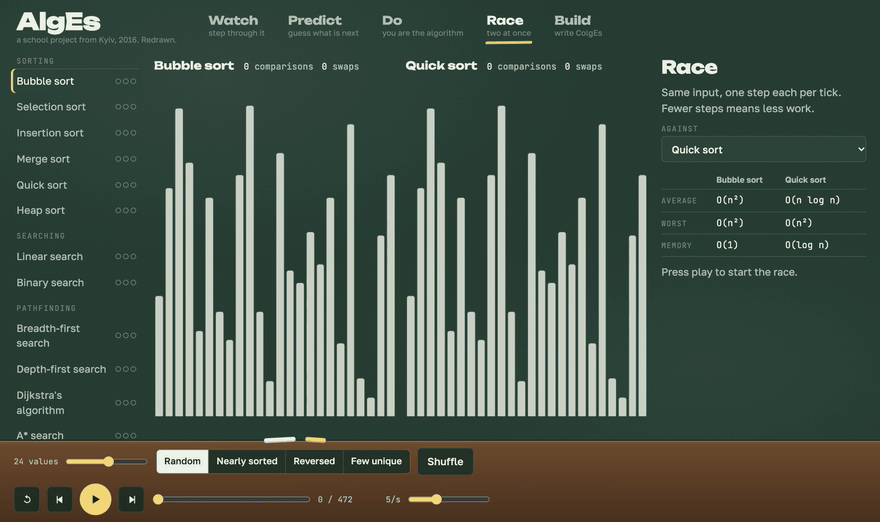
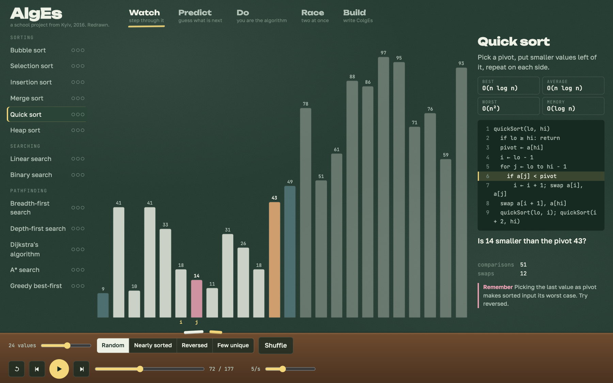
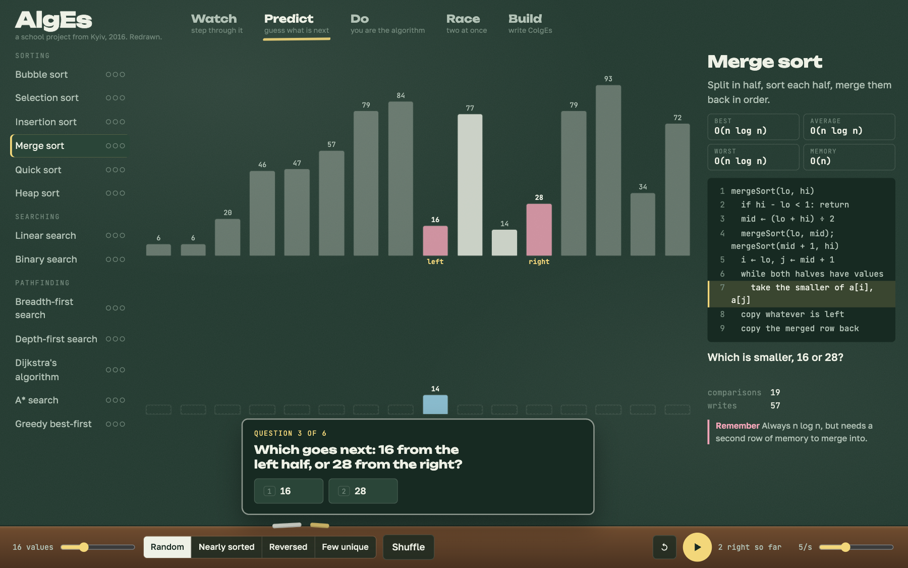
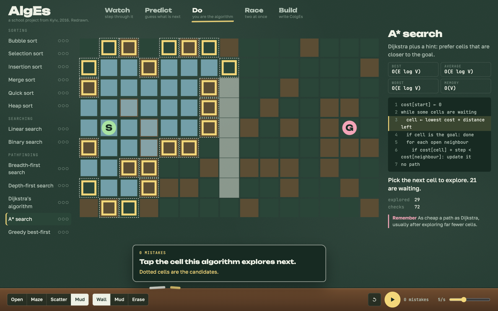
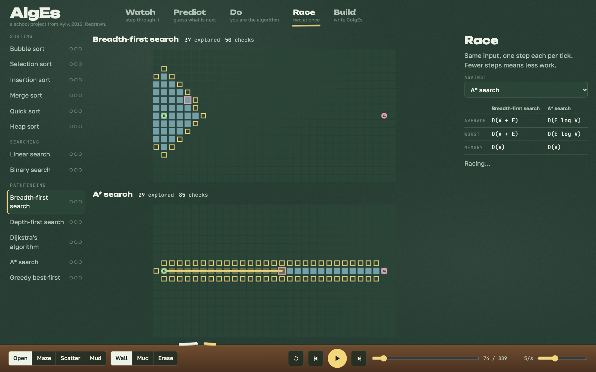
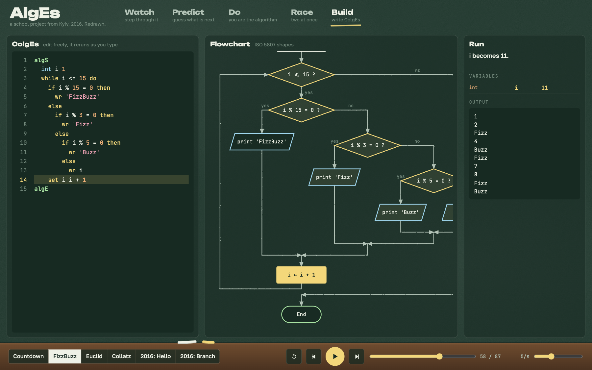
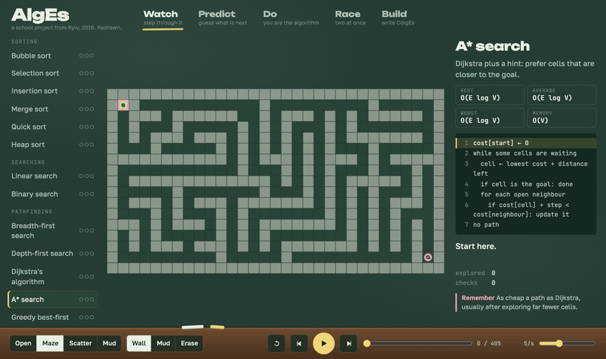
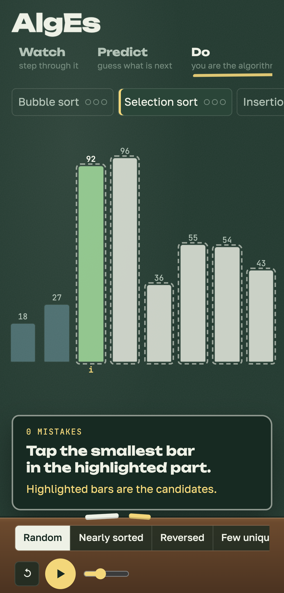
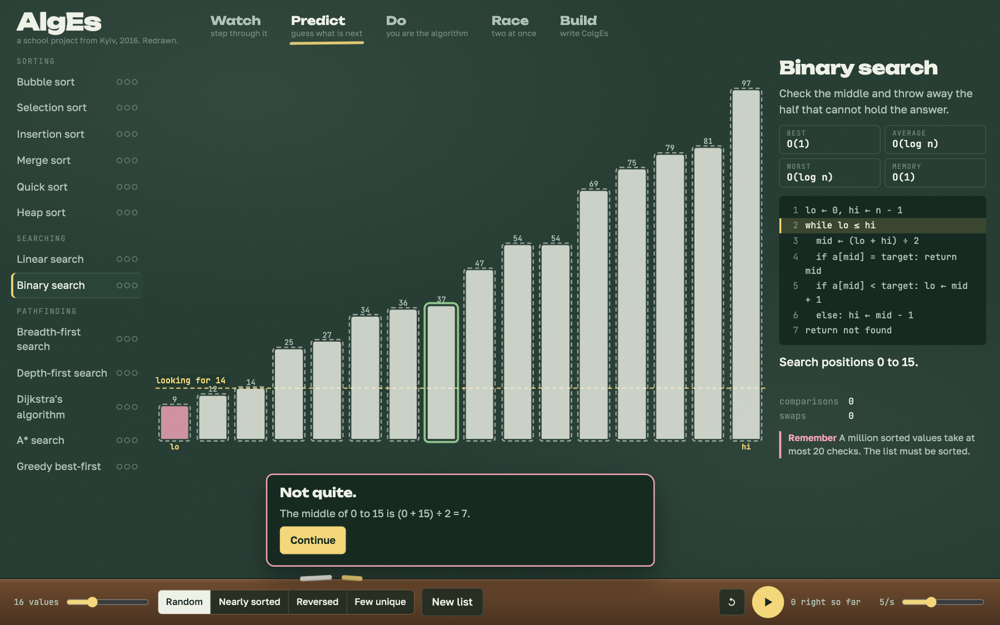

<p align="center">
  
</p>

<p align="center">
  <a href="https://github.com/nesdown/AlgEs/actions/workflows/ci.yml"></a>
  
  
  
  
</p>

<p align="center">
  <a href="#five-ways-to-learn"><b>Five ways to learn</b></a>
  &nbsp;·&nbsp;
  <a href="#thirteen-algorithms"><b>Algorithms</b></a>
  &nbsp;·&nbsp;
  <a href="#colges"><b>ColgEs</b></a>
  &nbsp;·&nbsp;
  <a href="#run-it"><b>Run it</b></a>
  &nbsp;·&nbsp;
  <a href="#the-story"><b>The story</b></a>
</p>

<br>

<p align="center">
  
  <br>
  <sub>Bubble sort against quick sort, on the same 24 values, one step each per tick.</sub>
</p>

<br>

> Reading about an algorithm is not the same as knowing it. AlgEs lets you watch one, guess its next move, make every decision yourself, race it against another, and finally write your own and see it drawn as a flowchart.

<br>

## Five ways to learn

<table>
  <tr>
    <td width="58%"></td>
    <td>
      <h3>1&nbsp;&nbsp;Watch</h3>
      <p>Step forwards and back through the run. The pseudocode line lights up, and every step is explained in a plain sentence.</p>
      <p><sub><kbd>Space</kbd> play &nbsp; <kbd>←</kbd> <kbd>→</kbd> step</sub></p>
    </td>
  </tr>
  <tr>
    <td>
      <h3>2&nbsp;&nbsp;Predict</h3>
      <p>The run stops six times, spread across the whole sort, and asks what happens next. A wrong guess shows the right answer and the reason.</p>
      <p><sub><kbd>1</kbd> <kbd>2</kbd> <kbd>3</kbd> answer &nbsp; <kbd>Enter</kbd> continue</sub></p>
    </td>
    <td width="58%"></td>
  </tr>
  <tr>
    <td width="58%"></td>
    <td>
      <h3>3&nbsp;&nbsp;Do</h3>
      <p>You are the algorithm. Swap or keep, tap the smallest bar, choose the next cell. Nothing moves until you decide, and every slip is counted.</p>
    </td>
  </tr>
  <tr>
    <td>
      <h3>4&nbsp;&nbsp;Race</h3>
      <p>Two algorithms, one input, one step each per tick. Watch breadth-first search spread in rings while A* walks straight to the goal.</p>
    </td>
    <td width="58%"></td>
  </tr>
  <tr>
    <td width="58%"></td>
    <td>
      <h3>5&nbsp;&nbsp;Build</h3>
      <p>Write <a href="#colges">ColgEs</a>. It is drawn as a flowchart as you type, then runs one step at a time with every variable in view.</p>
    </td>
  </tr>
</table>

<br>

## Thirteen algorithms

<p align="center">
  
  <br>
  <sub>A* through a maze. Draw your own walls and mud, and drag the start and the goal.</sub>
</p>

| | Algorithm | The idea | Average | Worst | Memory |
|---|---|---|:---:|:---:|:---:|
| **Sorting** | Bubble sort | Swap neighbours that are out of order until nothing moves. | <code>O(n²)</code> | <code>O(n²)</code> | <code>O(1)</code> |
| | Selection sort | Find the smallest value left and put it next. | <code>O(n²)</code> | <code>O(n²)</code> | <code>O(1)</code> |
| | Insertion sort | Slide each value left until it fits, like cards in your hand. | <code>O(n²)</code> | <code>O(n²)</code> | <code>O(1)</code> |
| | Merge sort | Split in half, sort each half, merge them back in order. | <code>O(n&nbsp;log&nbsp;n)</code> | <code>O(n&nbsp;log&nbsp;n)</code> | <code>O(n)</code> |
| | Quick sort | Pick a pivot, put smaller values left of it, repeat on each side. | <code>O(n&nbsp;log&nbsp;n)</code> | <code>O(n²)</code> | <code>O(log&nbsp;n)</code> |
| | Heap sort | Arrange values as a tree with the biggest on top, then keep taking the top. | <code>O(n&nbsp;log&nbsp;n)</code> | <code>O(n&nbsp;log&nbsp;n)</code> | <code>O(1)</code> |
| **Searching** | Linear search | Check every value until you find it. | <code>O(n)</code> | <code>O(n)</code> | <code>O(1)</code> |
| | Binary search | Check the middle and throw away the half that cannot hold the answer. | <code>O(log&nbsp;n)</code> | <code>O(log&nbsp;n)</code> | <code>O(1)</code> |
| **Pathfinding** | Breadth-first search | Explore in rings: every cell one step away, then two, then three. | <code>O(V&nbsp;+&nbsp;E)</code> | <code>O(V&nbsp;+&nbsp;E)</code> | <code>O(V)</code> |
| | Depth-first search | Go as deep as possible, back up only at dead ends. | <code>O(V&nbsp;+&nbsp;E)</code> | <code>O(V&nbsp;+&nbsp;E)</code> | <code>O(V)</code> |
| | Dijkstra's algorithm | Always continue from the cheapest place reached so far. | <code>O(E&nbsp;log&nbsp;V)</code> | <code>O(E&nbsp;log&nbsp;V)</code> | <code>O(V)</code> |
| | A* search | Dijkstra plus a hint: prefer cells that are closer to the goal. | <code>O(E&nbsp;log&nbsp;V)</code> | <code>O(E&nbsp;log&nbsp;V)</code> | <code>O(V)</code> |
| | Greedy best-first | Always head for whichever cell looks closest to the goal. | <code>O(E&nbsp;log&nbsp;V)</code> | <code>O(E&nbsp;log&nbsp;V)</code> | <code>O(V)</code> |

Sorts take random, nearly sorted, reversed or few unique values. Progress is kept in your browser as three dots per algorithm: watched, predicted, done.

<br>

## ColgEs

The little language from 2016, finished. Every program written back then still runs, word for word.

<table>
  <tr>
    <th width="50%">2016, still runs</th>
    <th width="50%">2026, what is new</th>
  </tr>
  <tr>
    <td valign="top">

```
algS
	int a 13

	if op a > 12 then
		op a * 5
	else
		op a - 2

	wr a
algE
```

</td>
    <td valign="top">

```
algS
  int n 5
  while n > 0 do
    wr n
    set n n - 1
  wr 'Liftoff!'
algE
```

</td>
  </tr>
</table>

<details>
<summary><b>The whole language on one card</b></summary>
<br>

| Write | Means |
|---|---|
| `algS` … `algE` | Start and end. Optional. |
| `int a 13` &nbsp; `str s 'hi'` &nbsp; `bool b true` | Make a typed variable. |
| `set a a * 5` &nbsp; `a = a * 5` | Change it. `op a * 5` is the 2016 spelling. |
| `wr a` | Print it. |
| `if a > 12 then` … `else` … | Branch, as an indented block or on one line. |
| `while a > 0 do` … | Loop. It was commented out in 2016. |
| `+ - * / %` | Whole-number maths. `7 / 2` is `3`. |
| `= != < > <= >=` &nbsp; `and or not` | Compare and combine. |
| `# note` &nbsp; `// note` | Comments. |

Mistakes name the line and say what to do, for example *a holds a number, so it cannot take text (hi).* A loop that never ends stops after 2,000 steps. Flowcharts use the ISO 5807 shapes taught in school.

</details>

<br>

## Made for small screens too

<table>
  <tr>
    <td width="30%" align="center"></td>
    <td width="70%" valign="top">
      <p>Every mode works on a phone. The algorithm list becomes a row you swipe, and the controls sit on the chalk tray under your thumb.</p>
      <br>
      
      <p><sub>Guess wrong and AlgEs shows the right answer, and why.</sub></p>
    </td>
  </tr>
</table>

<br>

## Run it

```bash
pnpm install
pnpm build    # writes dist/index.html, one page with everything inside
pnpm test     # every algorithm, every question, the language and the flowcharts
```

Open `dist/index.html` in any browser, or put it on any static host. `pnpm dev` rebuilds as you edit.

Links can open straight into a lesson: `#race.astar`, `#do.selection`, `#build`.

<br>

## How it works

Every algorithm runs once and records each step as a snapshot, so the run can be played, paused and scrubbed in both directions. Each decision point carries its own question and its own answer. Predict asks some of them. Do asks all of them.

The tests hold the whole thing honest. Every question's answer must be what the algorithm actually does next. Every pathfinder is checked against a brute-force shortest path, and every flowchart is checked for overlapping shapes.

```
src/algorithms   sorting, searching and pathfinding, each one a recorded trace
src/colges       tokenizer, parser, interpreter, flowchart layout
src/ui           bars, board, flowchart, editor and the five modes
test/            86 tests for the engine and the language
docs/            the images in this file, and the scripts that make them
```

<br>

## The story

In 2016, as a 10th-grader at the Dnipro Technical Lyceum in Kyiv, I built AlgEs to make learning algorithms simpler, starting from the flowcharts every beginner draws. It was a Java app with its own language, ColgEs, and it ran even on a Raspberry Pi B+. Ten years later, it got redrawn.

| | 2016 | 2026 |
|---|---|---|
| Runs on | Java, Swing, a Raspberry Pi B+ | Any browser, any phone |
| Learn by | Building a flowchart | Watching, predicting, doing, racing, building |
| Algorithms | The ones you drew | 13, from bubble sort to A* |
| ColgEs | `if`, `op`, `wr` | Plus `while`, `set`, logic, comments and clear errors |
| Flowcharts | Fixed pictures in a column | Laid out from the code, lit up as it runs |

<br>

<p align="center">
  
  
</p>

<p align="center"><sub>GPL-3.0, as the original. By Bohdan Hlushko.</sub></p>
